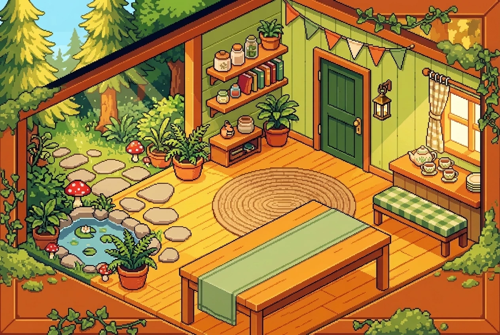

<div align="center">


# thingamingos

**和你一起生活过的物件朋友。**

A cozy pixel home for the things that share your life.

[玩法](#玩法) · [本地启动](#本地启动) · [运行与部署](docs/RUNNING.md) · [素材与 AI 声明](THIRD_PARTY.md)



<sub>原创像素小屋场景 · 开发预览</sub>

</div>

---

你的旧杯子、旅行时买的冰箱贴、一直放在床边的玩偶，都可以住进这个小屋。

给它一张照片、一个名字，再告诉它一件你们之间的小事。下一次聊天时，它会带着这些记忆开口。

一个这样的朋友，叫 **Thingamingo**：`thing`（物件）与 `amigo`（朋友）的相遇。

## 玩法

### 01 · 让一件物品住进来

上传照片，为它取名、写下物品类型和性格。浏览器会把照片转成像素小图标，保留原图供你对照；也可以选择保留背景的像素卡片或直接使用照片。

桌上一次坐三位伙伴。物品多了就换一组，收藏列表也可以搜索、翻页。

### 02 · 留下一点共同记忆

记下一段经历、一份礼物，或者一个还没兑现的约定。如果故事里有朋友，可以标注对方，让 TA 确认、补充，或保留不同的记法。

每条记忆都保留作者与确认状态。你可以修改它，也可以让物品忘掉它。

### 03 · 听它们聊一会儿

挑选一到三位伙伴，给一个话题，开一场小剧场。台词可以逐句播放、暂停和重播；引用到的记忆可以直接翻开。

配置模型服务后，剧场结合性格与记忆生成对话。没有配置、调用失败或输出不合要求时，会明确显示“规则生成”。台词不会自动写回记忆。

## 小屋里的细节

| 体验 | 当前版本 |
| --- | --- |
| 像素形象 | 照片通过浏览器内的规则算法转换，原图与像素图分别保存；内置物品使用对应图标 |
| 朋友与记忆 | 账号登录、共享小屋、人物标注、回应与确认状态 |
| 中英切换 | 界面与剧场随所选语言显示，用户姓名及记忆原文保留 |
| 小屋声音 | 原创田园配乐、轻点击与保存提示音；音乐和音效分别开关，音量可调 |
| 手机访问 | 适配 iPhone 尺寸，可通过 Safari 添加到主屏幕 |

音乐在首次点击或触控后开始，切到后台会暂停。上传视频目前用于保存与回放。

## 本地启动

需要 **Node.js 22.x** 和 npm。

```sh
npm ci
npm run preview
```

打开 **<http://127.0.0.1:18767/>**，首次使用注册自己的账号。无需预置测试账号，也不需要模型密钥就能体验规则剧场。

默认账号、记忆和上传素材保存在本机 `data/accounts-preview/`，不进入版本库。

```sh
npm run check
npm test
python3 -m unittest discover -s tests -p test_local.py
```

模型、账号与存储配置，以及 Vercel / 长运行容器的部署差异，见 [运行说明](docs/RUNNING.md)。

## 验证

当前版本通过 **128 项 Node 测试与 10 项 Python 测试**。浏览器已检查音乐启动、音乐与音效独立开关、静音及恢复音量；430 px iPhone 尺寸无横向溢出。

## 项目结构

```text
web/        像素小屋、照片转换、双语界面与声音
lib/        账号、记忆、剧场生成与存储逻辑
api/        Vercel API 入口
scripts/    账号迁移及部署包生成
tests/     交互、权限、持久化与剧场测试
server.js   本地账号版入口
```

## 版本边界

当前仓库提供开发预览源码。账号版正式发布需要持久化数据库与媒体存储；GitHub 仓库本身不是运行中的服务。

照片转像素在本机浏览器中执行，采用规则算法；视频目前不做内容理解或像素角色生成。手机浏览器尺寸已做验证，实际 iPhone 的主屏幕安装仍需真机验收。

物品串门、结伴出游和自动展开生活，是这个小屋接下来的设想。

## 制作与素材

网站使用原生 HTML、CSS 和 JavaScript，账号由 Better Auth 管理，剧场可选接入 DeepSeek。像素字体使用 [Fusion Pixel](https://github.com/TakWolf/fusion-pixel-font)，随仓库保留字体许可证。

代码与房间美术使用了 AI 辅助制作；BGM 和交互音效使用原创音序，通过 Web Audio 合成。具体来源、用途与验证方式见 [THIRD_PARTY.md](THIRD_PARTY.md)。

本项目尚未指定整体代码许可证；第三方组件和字体沿用各自的许可证。
